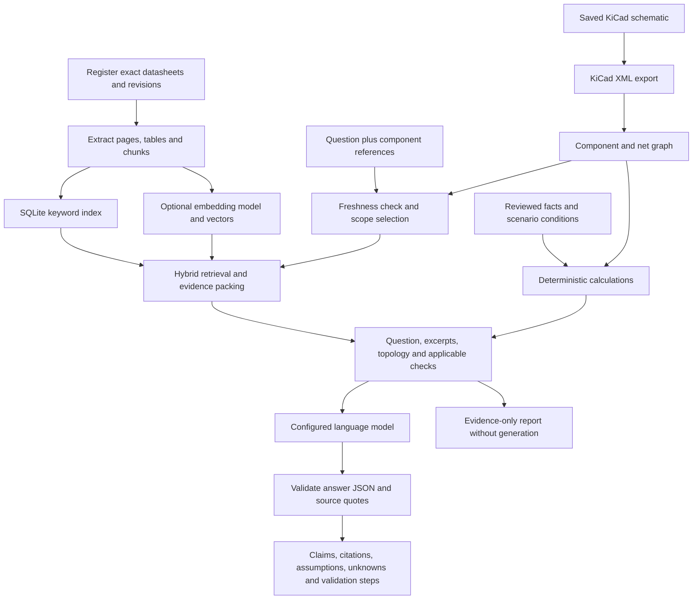

# How RAG works, and how this KiCad application uses it

## 1. What RAG is

Retrieval-augmented generation combines a search system with a language model. The search system finds relevant information from a selected document collection. The model receives those passages along with the question and uses them to formulate an answer.

Imagine an engineer with a searchable binder of the exact datasheets for a board. They first find the relevant pages, then compare specifications, inspect connections, calculate margins, and explain their conclusion with references. RAG automates parts of that workflow. The quality of the answer depends on both the right pages being found and the model reasoning correctly about them.

The index is a form of external memory. Adding another datasheet updates this memory; it does not normally change the language model's learned weights. A new board therefore needs a new project corpus and index, not model training from scratch.

Three distinct objects are often called “the model” in casual conversation:

1. **Embedding model:** converts text into numerical vectors for semantic search.
2. **Answer model:** reads the question and retrieved text, then generates language.
3. **Project knowledge store:** the actual datasheets, extracted pages, chunks, vectors, part mappings, connections and design assumptions.

In this application, the first two are interchangeable backends. The third belongs to each KiCad project.

## 2. Indexing happens before a question

Suppose your board uses a microcontroller, a sensor, a regulator and several interface devices. You register the specific datasheets, relevant errata and application notes, and map them to the exact manufacturer part numbers.

The ingestion pipeline performs the following operations:

1. Compute a SHA-256 digest of each source file. A changed digest indicates changed document content.
2. Extract text page by page. PDFs also get a best-effort pass for tables bounded by detectable lines. Text and Markdown files are supported for application notes and explicit project assumptions.
3. Record pages with very little text as potentially scanned, diagram-heavy or otherwise incomplete. An entirely unreadable document cannot become a successful index.
4. Split text into passages of roughly 2,200 characters with 250-character overlap by default. Chunks never cross physical PDF page boundaries, so page citations remain unambiguous.
5. Store extracted tables as additional passages, repeating the first extracted row as a candidate header. This is an aid to retrieval, not validated table interpretation.
6. Attach provenance: document ID, file path, exact part associations, title, document kind, revision, page number, chunk type and stable content-derived identifier.
7. Insert searchable text into SQLite FTS5. If embeddings are enabled, embed the passages and store their normalized vectors too.
8. Publish the new visible index in one SQLite transaction after extraction and embedding succeed.

If a network call fails during embedding, the previous index remains intact. Its freshness fingerprint still prevents it from silently representing the new configuration. Unchanged extracted files can reuse cached text; unchanged embedding inputs reuse stored vectors. Removing a registered document causes its passages to disappear from the next visible index.

The cache is per project. There is intentionally no automatic cross-project retrieval. You can reuse a datasheet source file by adding it to multiple projects, but each project's searchable set remains explicit.

## 3. What an embedding means

An embedding is a list of numbers that represents aspects of a passage's meaning. A question such as “Why is the regulator getting hot?” may be close to passages discussing thermal resistance and power dissipation even if those passages never say “getting hot.”

The question and document passages must use the same embedding model and compatible preprocessing. Vectors from unrelated embedding models cannot be mixed meaningfully just because they have the same number of dimensions.

The application normalizes vectors to length one. Similarity is then computed as a dot product:

```text
cosine_similarity(query, passage) = normalized_query · normalized_passage
```

A high similarity score indicates a search candidate. It is not a probability that a claim is correct, not confidence in a part's safety, and not proof the excerpt contains the answer.

The implementation scans stored vectors with NumPy. For a project with hundreds or a few thousand passages, this keeps installation and debugging straightforward. A fleet of projects with millions of passages would benefit from an approximate-nearest-neighbor index, stronger access control, background jobs and a server database. Those are future scaling changes rather than requirements for this local project tool.

## 4. Why keyword and semantic search are combined

Electronics retrieval needs exact strings as well as meaning. A semantic model may blur related part variants or confuse nearby concepts. Keyword search is valuable for strings such as `VOH`, `VIH`, an exact MPN, an interface name or a pin function.

This application retrieves candidates using:

- SQLite FTS5's BM25 ranking over title, part identifiers and text.
- Optional embedding similarity over passage vectors.
- A small explicit vocabulary expansion for terms such as compatible, voltage, startup, heat and I²C.

It combines independent rankings using reciprocal rank fusion:

```text
fused_score(chunk) = sum(1 / (60 + rank_in_each_search_list))
```

The fusion formula rewards passages that rank well in more than one search method without pretending that raw BM25 and vector scores have the same meaning. Requested components receive a small evidence allocation before the rest of the context is filled. Repeated passages from the same page are limited so one page is less likely to dominate.

This is a useful baseline, not a trained electrical-engineering retriever. It has no cross-encoder reranker, learned query planner or calibrated abstention classifier. Vocabulary mismatch, long multi-part questions and incomplete source chunks remain possible failures. The retrieval evaluation script makes some of those failures observable.

## 5. What KiCad adds

Datasheets tell you what individual components support. They cannot tell you how your schematic connects them. For interaction questions, the software also needs the board's connectivity.

The application asks the installed `kicad-cli` to export a KiCad XML netlist. It parses:

- Component reference, value, available MPN fields, footprint and sheet information.
- Pin number, available pin name/function and electrical type.
- Net names and the reference/pin endpoints on each net.
- DNP markers when present in the export.

These form a component-and-net graph. There is no need to infer connections from a screenshot or the visual placement of symbols.

When a question mentions `U1` and `U2`, the application identifies those components, gathers their nets and expands to directly connected neighbors. Datasheets mapped to these exact parts become the retrieval scope. Large nets can connect many devices, so neighbor expansion is limited and reported. The full net's endpoints can still be present in the selected topology evidence if the context budget permits.

For a question naming only a part number, exact part matches in the graph can resolve the corresponding references. When no component or net is resolved, document retrieval can still run, but the response is told that no circuit scope was selected. Passing `--refs U1 U2` avoids ambiguity.

A graph edge means “connected in the exported schematic.” It does not mean “will conduct under every state,” “causes failure,” or “transmits a valid signal.” A path can run through shared ground or a passive component and say little about useful signal flow. MOSFET conduction, diode states, analog transfer functions, timing and power sequencing require additional models or analysis.

The application therefore uses graph context as evidence and labels interaction conclusions as inferences.

## 6. The complete path for a question



In code, `build_bundle` assembles the evidence. `ask` optionally calls the answer provider. `validate_answer` validates the answer structure and citations, and `render` produces a readable Markdown report. JSON reports retain machine-readable provenance for later evaluation.

The answer model gets actual passage text, not the embedding vectors. Embeddings are used to find text; the language model reasons over the retrieved text and supplied context.

The model is asked to produce separate claim types:

| Claim type | Meaning |
|---|---|
| Documented | Directly supported by supplied sources |
| Inference | A conclusion drawn from facts and circuit conditions |
| Recommendation | A proposed design or validation action grounded in the evidence |
| Unknown | The required information is missing or cannot be established |

Every non-unknown claim needs a citation with a short quoted span. The software rejects invented source IDs and quotations that do not occur in the cited excerpt. A response that cannot pass this check is withheld rather than silently shown as validated.

This is deliberately narrower than “hallucination-proof.” A model can quote the right sentence and draw the wrong conclusion. It can confuse test conditions, incorrectly apply an equation, overlook a missing operating corner or repeat instructions embedded in source material despite the system prompt. Human review and independent verification still matter.

## 7. Worked interaction example: logic compatibility

The shipped teaching fixture contains fictional parts:

- `U1`, `DEMO-MCU-33`, has `VOH(min) = 2.4 V` and `VOL(max) = 0.4 V` under its specified example conditions.
- `U2`, `DEMO-SENSOR-5`, requires `VIH(min) = 3.5 V` and permits `VIL(max) = 1.5 V` under its specified example conditions.
- The netlist places `U1.3` and `U2.3` on `GPIO_LINK`.

Ask: “Can U1 reliably drive U2?”

The application retrieves evidence for both parts and the direct pin connection. The configured logic check uses:

```text
High noise margin = VOH(min) - VIH(min) = 2.4 - 3.5 = -1.1 V
Low noise margin  = VIL(max) - VOL(max) = 1.5 - 0.4 =  1.1 V
```

The high state is not guaranteed to be recognized under the supplied bounds. The low-level comparison has positive margin. A complete answer should explain that distinction and flag what this check does not establish: pin overvoltage, overshoot, startup behavior, temperature corners outside the supplied conditions, capacitive loading and timing.

A useful recommendation might be to investigate a level translator or a receiver with compatible guaranteed thresholds. The system should not invent a substitute part or assert that a generic resistor divider solves every interface direction. Candidate substitutions would need their own datasheets and checks.

The arithmetic happens in Python because these equations are fixed and auditable. The language model's role is to connect the result to the user's question and explain consequences and missing evidence.

## 8. Worked interaction example: a shared power supply

The fictional LDO example uses a 12 V input, 3.3 V output, 0.2 A load, 0.005 A ground current, 40 °C ambient, and 100 K/W junction-to-ambient thermal resistance for an assumed board.

```text
P = (Vin - Vout) × Iout + Vin × Iq
  = (12 - 3.3) × 0.2 + 12 × 0.005
  = 1.8 W

Tj_estimate = Ta + P × thetaJA
            = 40 + 1.8 × 100
            = 220 °C
```

The estimate is above the fixture's 125 °C recommended limit. It indicates that this steady-state operating scenario does not satisfy the thermal constraint. It does not establish that the real part would remain operating until it physically reached 220 °C; current limiting, thermal shutdown, output collapse, or failure may intervene.

The netlist helps identify which devices share the supply, but it does not provide all their current consumption. A load budget must explicitly include maximum and transient currents, duty cycles, external connectors and possible simultaneous operating modes. The board's thermal resistance also cannot be inferred accurately from the schematic alone.

This illustrates the division of labor: retrieval finds the specifications, the graph supplies topology, reviewed scenario facts supply operating conditions, Python calculates the estimate, and the answer model explains the conditional conclusion.

## 9. Why reviewed facts are separate from raw extraction

Datasheets are difficult documents. A table might contain minimum, typical and maximum values across several supply voltages, test loads, temperature ranges and package variants. OCR can turn `µA` into `mA` or lose a minus sign. A figure may describe typical characterization, not a guaranteed production limit.

Automatically promoting every extracted number into a design rule would make the system more convenient but less trustworthy. Version 1 instead keeps raw passages searchable and requires explicit review before a value is used in a deterministic check.

A reviewed fact includes the numeric value, canonical unit, operating condition, source document, physical page, a verbatim quote, and the relevant component reference. User-specified scenario inputs are marked separately. Each complete check also requires confirmation that its input conditions belong together.

The software checks schema, units, source existence, quotation presence, component-to-document mapping and certain endpoint relationships. It does not verify that the human correctly transcribed the number or that the chosen conditions are the most conservative. `reviewed=true` is an assertion of that review, not an automatic certificate.

## 10. Reusing the system for another board

Create another assistant folder, import the new schematic and add that board's documents. You can use the same embedding and answer models. Build the new project's index, resolve missing MPN mappings, then ask questions with references from the new schematic.

After edits, save the schematic, run `sync-kicad`, update document registrations or design conditions, and run `index`. Old answer reports remain snapshots of old evidence. Their stored fingerprints are useful provenance, but the application does not replay or automatically revalidate historical answers.

For design variants, use separate assistant folders or carefully update the exported variant and facts. Do not assume the same reference designator represents the same part in another project.

## 11. How to measure whether it is useful

Start with questions whose answers you have already checked. Include exact part lookups, questions using different wording, cross-part comparisons, intentionally missing facts and stale revisions.

Measure retrieval before judging generation. If the correct page never reaches the answer model, a stronger model may simply produce a more convincing guess. Useful criteria include:

- Whether all needed source documents and pages appear in the selected evidence.
- Whether exact variants, revisions and operating conditions remain distinct.
- Whether fabricated citations and quotations are rejected.
- Whether the model says “unknown” when the needed evidence is absent.
- Whether calculations use the intended units and worst-case inputs.
- Whether answers describe what remains untested.

The included retrieval evaluator checks expected document hits on the fictional demo. Its score measures this tiny fixture, not general electronics expertise. The automated tests exercise software behavior with explicit model doubles. A live provider and representative real-board evaluation are separate activation steps.

## 12. Extensions worth considering after real usage

The next useful additions depend on observed failures: OCR integration, multimodal reading of charts and pin diagrams, more robust layout-aware table extraction, manually reviewed parameter cards, learned reranking, multi-hop question decomposition, SPICE model import, ERC/DRC report ingestion, firmware configuration data, PCB geometry, and revision-diff review.

These are not currently implemented. In particular, a retrieval graph is not a circuit simulator. Adding simulation would require valid device models, initial conditions, test benches and comparison against measurements; simply connecting an LLM to a netlist does not supply those things.

## Official references

The implemented interfaces follow [KiCad's command-line documentation](https://docs.kicad.org/10.0/en/cli/cli.html), [Ollama embeddings](https://docs.ollama.com/api/embed), [Ollama chat](https://docs.ollama.com/api/chat), [OpenAI embeddings](https://developers.openai.com/api/reference/resources/embeddings/methods/create), and [OpenAI text generation](https://developers.openai.com/api/docs/guides/text).

The I²C pull-up equations used by the optional deterministic check are described in [Texas Instruments SLVA689](https://www.ti.com/lit/pdf/slva689). The software implementation, illustrative values and design boundaries are explained separately above and in the design-check guide.
